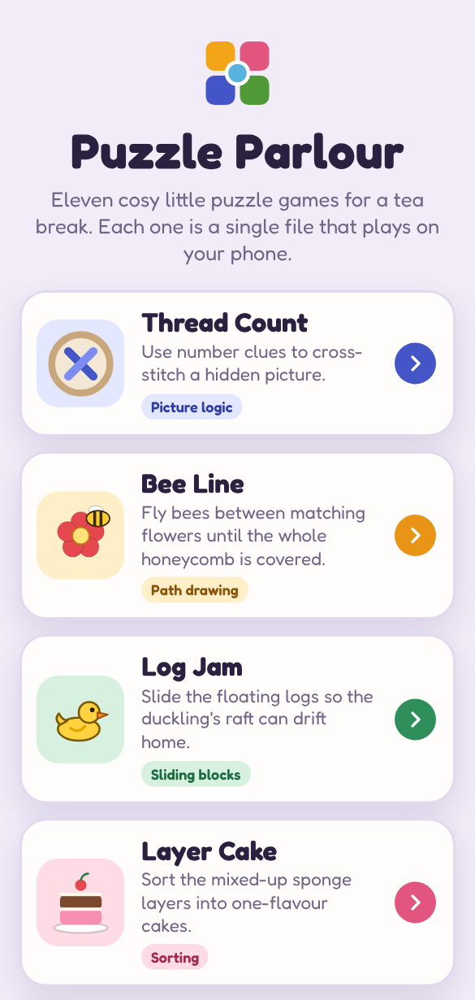

# Puzzle Parlour

Eleven cosy, phone-friendly puzzle games, each a single self-contained HTML file in the same spirit as [Whisker Hunt](https://github.com/HamiltonSteff/Whisker-Hunt). Each takes a well-known puzzle format and gives it its own twist and theme.

**▶️ Play now: <https://olkham.github.io/puzzle-parlour/>**



| Game | Style | Based on | The twist |
| --- | --- | --- | --- |
| [🧵 Thread Count](thread-count/) | Picture logic | Nonograms | Cross-stitch: finished pictures bloom into colour and fill your sampler |
| [🐝 Bee Line](bee-line/) | Path drawing | Flow | Played on a honeycomb, with smooth bee flight paths |
| [🦆 Log Jam](log-jam/) | Sliding blocks | Rush Hour | A river of logs and rocks, with exact par for every level |
| [🍰 Layer Cake](layer-cake/) | Sorting | Water sort | Cake layers with flavour patterns, plus mystery bakes |
| [🌱 Green Thumb](green-thumb/) | Pipe rotation | Net / Pipe Mania | Live water flow, blooming seedlings and pinnable tiles |
| [🧶 Fair Isle](fair-isle/) | Colour picture logic | Colour nonograms | Knitting in up to four yarns; finished pieces become jumpers, mittens and hats |
| [🪟 Sun Catcher](sun-catcher/) | Mosaic logic | Fill-a-Pix | Stained glass: finished windows light up pane by pane as the sun pours through |
| [🪡 Patchwork](patchwork/) | Area division | Shikaku | Every patch gets a fabric print, and finished quilts are stitched and bound |
| [🐷 Truffle Hunt](truffle-hunt/) | Number logic | Minesweeper | Never a guess: every board is solver-checked from the pig's clearing |
| [🐑 Fence Line](fence-line/) | Loop logic | Slitherlink | Close the fence and the flock hops into a blooming paddock |
| [🧪 Potion Shelf](potion-shelf/) | Colour sorting | Water sort | Real pours: tip a bottle and the potion streams across; finished potions are corked and labelled |

Every game has hand-tuned or solver-verified levels, a level picker, three-star or three-heart scoring, undo or hints where they fit, light and dark mode, saved progress, and procedural background music and sound effects (no audio files). The games with fine-grained boards (all but Log Jam, Layer Cake and Potion Shelf, whose pieces stay big) let you pinch to zoom in on big boards and drag around them; on desktop, the mouse wheel and the + − 0 keys do the same.

## Getting started

Any of these works — pick whichever is easiest.

**1. Play online.** Open <https://olkham.github.io/puzzle-parlour/> in any browser, on a computer or a phone. Nothing to download, and you can install it as an app from there (see [Installing on a phone](#installing-on-a-phone)).

**2. Just open it.** Double-click `index.html` (the launcher) or any game's `index.html`. Nothing to install.

**3. Run a local server** (lets you play on your phone over Wi-Fi, with a QR code to scan):

```bash
./install.sh      # Windows: install.bat
./run.sh          # Windows: run.bat
```

`install` creates a small Python virtual environment in `.venv` (it checks for both `python` and `python3` and asks which to use). It's safe to run again; `--clean` deletes `.venv` and starts fresh, `--python PATH` skips the question and `--yes` takes the default. `run` serves everything at <http://localhost:8080> and prints a link and QR code for your phone; it accepts `--port`, `--host` and `--no-browser`.

**4. Docker.** No Python needed:

```bash
docker compose up -d        # then open http://localhost:8080
docker compose down         # to stop
```

Set `PORT=9000` to use a different port.

## Publishing on GitHub Pages

Each game folder is ready to be its own repo, just like Whisker Hunt: an `index.html` with everything inlined, a `README.md`, a `screenshot.png`, and the app files (`manifest.json`, `sw.js`, `icons/`). Push a folder's contents to a new repo and turn on **Settings → Pages → Deploy from a branch → `/ (root)`**.

Or publish the whole collection as one repo: the launcher at the root links to every game.

## Installing on a phone

Every game, and the launcher itself, is an installable web app with its own name and icon. Open it from an HTTPS address (GitHub Pages works), then:

- **Android (Chrome):** tap **Install app** when it's offered, or **⋮** menu → **Install app**.
- **iPhone / iPad (Safari):** **Share** → **Add to Home Screen**.

Install the games one by one for separate icons, or install the launcher for a single Puzzle Parlour app. Installed apps open full screen and work offline after their first visit. On iPhone and iPad a home-screen app keeps its own saved progress, separate from Safari's.

Two places this won't work: the local server over Wi-Fi (`http://192.168…` isn't HTTPS, so Android won't install from it), and a page opened straight from a file.

## Project layout

```
index.html          the launcher (shows how many levels you've solved in each game)
manifest.json       app details for installing the launcher
sw.js               offline support for the launcher (it also keeps all eleven games)
icons/              home-screen icons
thread-count/       each game: index.html (everything inlined), manifest.json, sw.js, icons/, README.md, screenshot.png
bee-line/
log-jam/
layer-cake/
green-thumb/
fair-isle/
sun-catcher/
patchwork/
truffle-hunt/
fence-line/
potion-shelf/
serve.py            tiny local web server with a phone QR code
install.sh/.bat     sets up .venv for serve.py
run.sh/.bat         starts serve.py
docker-compose.yml  nginx alternative
```

Each game saves its own progress in the browser's `localStorage` under its own key; the launcher just reads those to show how many levels you've solved.
