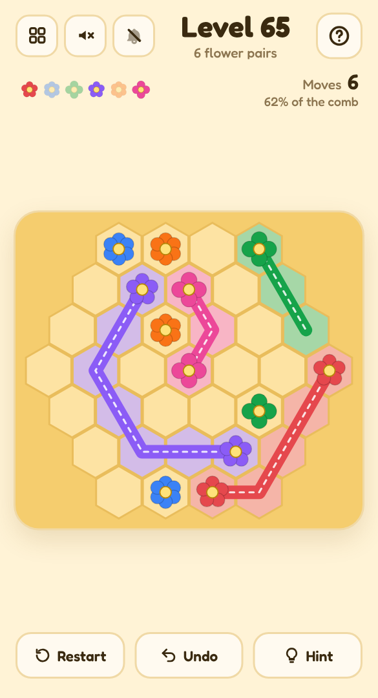

# 🐝 Bee Line

A mobile-friendly, single-file HTML path-drawing puzzle on a honeycomb, in the style of *Flow*. Guide a bee between each pair of matching flowers — trails can't cross, and the whole comb must be covered.

## Play it

The whole game is this folder's `index.html`: open it directly in any browser (phone or desktop), or host it with GitHub Pages:

1. Put this folder's files in a GitHub repo.
2. In the repo, go to **Settings → Pages**, set **Source** to **Deploy from a branch**, pick your branch and `/ (root)`, then **Save**.
3. The game goes live at `https://<your-username>.github.io/<repo-name>/`.

No build step and nothing to install. CSS, JavaScript, levels and audio are all inlined in `index.html`; the other files (`manifest.json`, `sw.js` and `icons/`) only make it installable as an app.

## Install it on your phone

Once it's hosted over HTTPS (GitHub Pages is perfect), open it on the phone, then:

- **Android (Chrome):** tap **Install app** when it's offered, or open the **⋮** menu → **Install app** (or **Add to Home screen**).
- **iPhone / iPad (Safari):** tap **Share** → **Add to Home Screen**.

It gets its own icon, opens full screen without the browser bars, and works offline after the first visit. On iPhone and iPad the home-screen app keeps its own saved progress, separate from Safari's.

## How to play

- **Drag** from a flower to draw a trail to its twin. Fast swipes are fine; the trail fills in every cell you pass.
- Trails can't cross. Drawing over another trail **cuts** it — back off and it grows back.
- Tap a flower to clear its trail, or drag from the middle of a trail to redraw from there.
- Cover **every cell** of the honeycomb to finish.
- Big comb? **Pinch** to zoom in, and drag with two fingers (or one finger from an empty cell) to look around. The magnifier button zooms back out.
- Link each pair in a single move for a **perfect three stars**. **Undo** steps back a move; **Hint** lays down one true trail (and caps the level at two stars).

## Features

- Played on **hexagonal honeycomb boards** — hexagon and rectangle shapes, from 19 to 91 cells and 3 to 11 flower pairs.
- **240 built-in levels**, then endless new ones generated on your device. Every level has exactly one answer made of smooth bee flight paths, checked by a solver before you see it.
- Each colour also has its own petal count, so pairs are easy to tell apart.
- **Pinch to zoom** on big combs. One finger still draws: a touch waits a moment before it counts, so starting a pinch on a flower never clears its trail. On desktop, the mouse wheel or a trackpad pinch zooms, middle-drag moves around, and **+**, **−** and **0** zoom from the keyboard.
- A bee buzzes along each trail as you complete it, and the whole hive takes off when you win.
- Light and dark mode, safe-area-aware layout and big tap targets, so it plays well one-handed on a phone.
- **Background music** and **sound effects**, each off by default and toggled separately from the header. All audio is synthesised live with the Web Audio API — there are no audio files.
- Progress saves in your browser (`localStorage`), including a level you're halfway through.
- A level picker (20 per page) shows your best result for every level you've finished.

Part of the [Puzzle Parlour](../README.md) collection.
