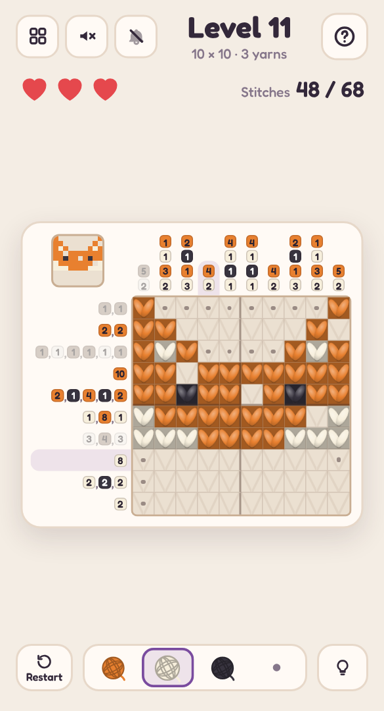

# 🧶 Fair Isle

A mobile-friendly, single-file HTML picture-logic puzzle in the style of a colour nonogram — told as knitting. Use the coloured number clues to knit a hidden picture; when it's done, the background knits itself in row by row and the finished piece goes onto a jumper, mitten, bobble hat, scarf or cushion in your wardrobe.

## Play it

The whole game is this folder's `index.html`: open it directly in any browser (phone or desktop), or host it with GitHub Pages:

1. Put this folder's files in a GitHub repo.
2. In the repo, go to **Settings → Pages**, set **Source** to **Deploy from a branch**, pick your branch and `/ (root)`, then **Save**.
3. The game goes live at `https://<your-username>.github.io/<repo-name>/`.

No build step and nothing to install. CSS, JavaScript, levels and audio are all inlined in `index.html`; the other files (`manifest.json`, `sw.js` and `icons/`) only make it installable as an app.

## Install it on your phone

Once it's hosted over HTTPS (GitHub Pages is perfect), open it on the phone, then:

- **Android (Chrome):** tap **Install app** when it's offered, or open the **⋮** menu → **Install app** (or **Add to Home screen**).
- **iPhone / iPad (Safari):** tap **Share** → **Add to Home Screen**.

It gets its own icon, opens full screen without the browser bars, and works offline after the first visit. On iPhone and iPad the home-screen app keeps its own saved progress, separate from Safari's.

## How to play

- Each row and column has clues: its runs of stitches, in order, each number shown on a chip of its yarn's colour.
- Runs of the **same** yarn are separated by at least one empty square. Runs of **different** yarns can touch.
- Pick a yarn from the basket at the bottom, then **tap or drag** across squares to knit them. A wrong stitch shows a red cross and costs one of your **3 hearts** (knit the wrong yarn and the right one is knitted in for you).
- Pick the **dot** to mark squares you know are empty (dots are just notes; they never cost a heart).
- Finished rows and columns grey out and their leftover squares are dotted for you.
- Stuck? The **bulb** highlights a square that one row or column already pins down, tells you which yarn it needs, and picks that yarn up for you.
- Big piece? **Pinch** to zoom in, and drag with two fingers (or one finger along the clues) to look around. The clues stay pinned to the edges of the grid, and the magnifier button zooms back out.
- Every puzzle has exactly one answer, and logic alone gets you there — never guessing.

## Features

- **24 hand-made pictures** (5×5 up to 15×15, plus a 15×10) — a heart, a toadstool, a bobble hat, a fox, an owl, a snowman, a hedgehog, a Shetland star and more — in 2 yarns at first and up to 4 later, then **endless Fair Isle colourwork**: mirror-symmetric stars, snowflakes and medallions, and yokes of little repeating "peerie" bands, in a dozen colourways. Every level is checked with a line-by-line colour logic solver before you see it.
- Knitted squares are drawn as little **V stitches** in their yarn, on plain knitted fabric.
- When you finish, the stitches settle and the background is **knitted in from the bottom up**, then the piece appears on a garment. Finished pieces show as tiny garments in the level picker — your wardrobe.
- A live mini-preview of your knitting in the corner.
- **Pinch to zoom** on big pieces, with the clues pinned to the edges while you look around. One finger still knits: a touch waits a moment before it counts, so starting a pinch never costs a heart.
- Keyboard play on desktop: arrow keys move, **1–4** pick a yarn, Enter knits, X marks. Right-click marks too. The mouse wheel or a trackpad pinch zooms, middle-drag moves around, and **+**, **−** and **0** zoom from the keyboard.
- Light and dark mode, safe-area-aware layout and big tap targets, so it plays well one-handed on a phone.
- **Background music** (a slow fireside air, with the fire crackling) and **sound effects** (needle clicks, a chime for every finished line, a warm flourish when a piece is done), each off by default and toggled separately from the header. All audio is synthesised live with the Web Audio API — there are no audio files.
- Progress saves in your browser (`localStorage`), including a level you're halfway through.
- A level picker (20 per page) shows your best result for every level you've finished.

Part of the [Puzzle Parlour](../README.md) collection.
