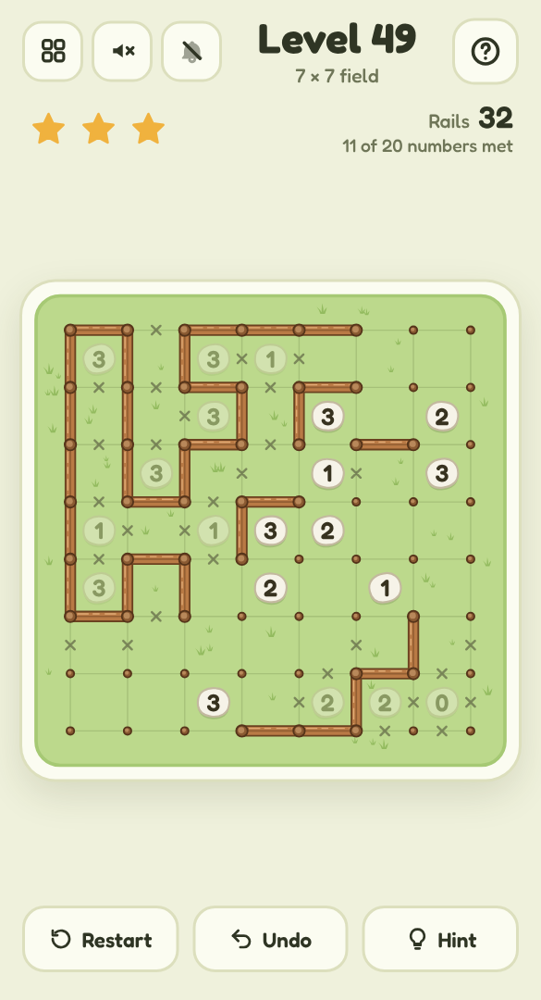

# 🐑 Fence Line

A mobile-friendly, single-file HTML loop-logic puzzle in the style of Slitherlink — told as a sheep farm. Build one fence around the field using the numbers on the stones; when the loop is closed, the paddock turns lush, flowers open and the flock hops in through the gate.

## Play it

The whole game is this folder's `index.html`: open it directly in any browser (phone or desktop), or host it with GitHub Pages:

1. Put this folder's files in a GitHub repo.
2. In the repo, go to **Settings → Pages**, set **Source** to **Deploy from a branch**, pick your branch and `/ (root)`, then **Save**.
3. The game goes live at `https://<your-username>.github.io/<repo-name>/`.

No build step and nothing to install. CSS, JavaScript, levels and audio are all inlined in `index.html`; the other files (`manifest.json`, `sw.js` and `icons/`) only make it installable as an app.

## Install it on your phone

Once it's hosted over HTTPS (GitHub Pages is perfect), open it on the phone, then:

- **Android (Chrome):** tap **Install app** when it's offered, or open the **⋮** menu → **Install app** (or **Add to Home screen**).
- **iPhone / iPad (Safari):** tap **Share** → **Add to Home Screen**.

It gets its own icon, opens full screen without the browser bars, and works offline after the first visit. On iPhone and iPad the home-screen app keeps its own saved progress, separate from Safari's.

## How to play

- The field is a grid of wooden posts. Draw **one closed fence** along the lines between them: no branches, no crossings, no loose ends.
- A number on a stone says how many of its square's four sides are fenced. Squares without a stone can have any number.
- **Tap** a side to put up a rail, tap again to mark it **x** (no fence), and once more to clear it. Taps pick the side nearest your finger, so you don't have to be precise.
- **Drag** along the lines to lay fence post by post; drag back over the last rail to take it up again. A drag that starts on an existing rail lifts rails instead.
- A number fades once its count is met and turns red when it can't be. A post with three or more rails, or a loop that closes while other rails lie outside it, glows red.
- Stuck? The **bulb** settles one side and explains the rule behind it ("A 3 in a corner fences both outer sides", "A post can't have a dead end", "This would close a small loop"…). Finish without a hint for **3 stars**; one hint gives 2, more give 1.
- Big field? **Pinch** to zoom in, and drag with two fingers (or one finger from the middle of a square) to look around. The magnifier button zooms back out.
- Every puzzle has exactly one answer, and logic alone gets you there — never guessing.

## Features

- **150 hand-picked fields** (3×3 up to 10×14), sorted from a tiny first lesson to big tricky meadows, then **endless fresh fields** grown on your device. Every one is checked by a logic solver that never guesses, so it has a single answer you can reason your way to.
- On a win, the enclosed field ripples into lush grass with flowers, the gate swings open and a few sheep hop in and settle down to graze. Finished paddocks appear as thumbnails in the level picker — your farm.
- Hints that teach: each one names the rule it used, from counting and dead ends to corner patterns.
- **Pinch to zoom** on big fields, with generous side-picking that still works zoomed in. One finger still plays: a touch waits a moment before it counts, so starting a pinch never puts up a rail.
- Undo, restart, keyboard play on desktop (arrows walk between posts, Shift+arrow lays or lifts a rail, hold X and press an arrow to cross a side out, Ctrl+Z undoes) and right-click to cross a side. The mouse wheel or a trackpad pinch zooms, middle-drag moves around, and **+**, **−** and **0** zoom from the keyboard.
- Light and dusk (dark) mode, safe-area-aware layout and big tap targets, so it plays well one-handed on a phone.
- **Background music** (a lazy pastoral tune on a pipe over soft strings) and **sound effects** (a wooden knock for each rail, a soft pluck for an x, a bleating chord when the flock moves in), each off by default and toggled separately from the header. All audio is synthesised live with the Web Audio API — there are no audio files.
- Progress saves in your browser (`localStorage`), including a field you're halfway through.
- A level picker (20 per page) shows your best stars for every level you've finished.

Part of the [Puzzle Parlour](../README.md) collection.
