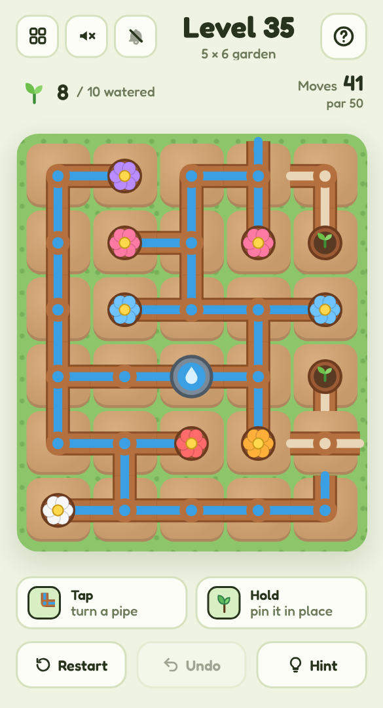

# 🌱 Green Thumb

A mobile-friendly, single-file HTML pipe-rotation puzzle in the style of *Net* and *Pipe Mania*, set in a garden. Turn the pipes so water from the well reaches every seedling — with no leaks.

## Play it

The whole game is this folder's `index.html`: open it directly in any browser (phone or desktop), or host it with GitHub Pages:

1. Put this folder's files in a GitHub repo.
2. In the repo, go to **Settings → Pages**, set **Source** to **Deploy from a branch**, pick your branch and `/ (root)`, then **Save**.
3. The game goes live at `https://<your-username>.github.io/<repo-name>/`.

No build step and nothing to install. CSS, JavaScript, levels and audio are all inlined in `index.html`; the other files (`manifest.json`, `sw.js` and `icons/`) only make it installable as an app.

## Install it on your phone

Once it's hosted over HTTPS (GitHub Pages is perfect), open it on the phone, then:

- **Android (Chrome):** tap **Install app** when it's offered, or open the **⋮** menu → **Install app** (or **Add to Home screen**).
- **iPhone / iPad (Safari):** tap **Share** → **Add to Home Screen**.

It gets its own icon, opens full screen without the browser bars, and works offline after the first visit. On iPhone and iPad the home-screen app keeps its own saved progress, separate from Safari's.

## How to play

- **Tap** a tile to turn it a quarter turn clockwise.
- Water flows out from the **well** through joined pipes, live as you turn them. Seedlings **bloom** when water reaches them.
- Every tile must be joined up, with no pipe ending in mid-air. There are no loops: every pipe has exactly one route back to the well.
- **Press and hold** (or right-click) to pin a tile you're sure of, so you can't turn it by accident.
- Finish near **par** — the fewest turns — for three stars. **Undo** is free; **Hint** turns and pins one tile for you (and caps the level at two stars).

## Features

- **Endless gardens** generated on your device from random spanning trees, from 3×3 up to 8×10.
- Water visibly travels outward through newly joined pipes, and open pipe ends drip.
- Pots and the well stay upright while the pipes turn beneath them.
- Keyboard play on desktop: arrow keys move between tiles, Enter turns, P pins.
- Light and dark mode, safe-area-aware layout and big tap targets, so it plays well one-handed on a phone.
- **Background music** and **sound effects**, each off by default and toggled separately from the header. All audio is synthesised live with the Web Audio API — there are no audio files.
- Progress saves in your browser (`localStorage`), including a level you're halfway through.
- A level picker (20 per page) shows your best result for every level you've finished.

Part of the [Puzzle Parlour](../README.md) collection.
