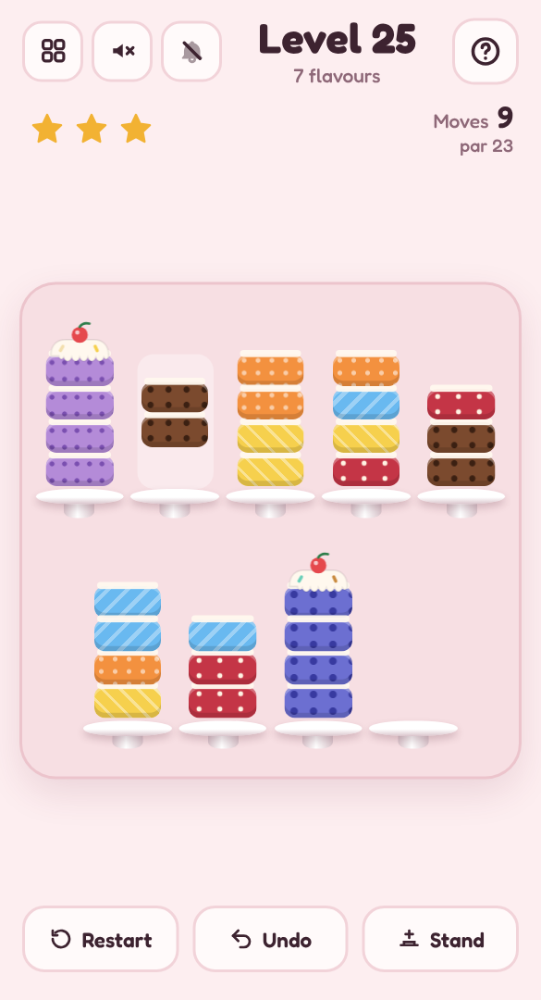

# 🍰 Layer Cake

A mobile-friendly, single-file HTML sorting puzzle in the style of *water sort*, set in a bakery. The sponges are all mixed up — move the layers between stands until every stand holds a cake of one flavour.

## Play it

The whole game is this folder's `index.html`: open it directly in any browser (phone or desktop), or host it with GitHub Pages:

1. Put this folder's files in a GitHub repo.
2. In the repo, go to **Settings → Pages**, set **Source** to **Deploy from a branch**, pick your branch and `/ (root)`, then **Save**.
3. The game goes live at `https://<your-username>.github.io/<repo-name>/`.

No build step and nothing to install. CSS, JavaScript, levels and audio are all inlined in `index.html`; the other files (`manifest.json`, `sw.js` and `icons/`) only make it installable as an app.

## Install it on your phone

Once it's hosted over HTTPS (GitHub Pages is perfect), open it on the phone, then:

- **Android (Chrome):** tap **Install app** when it's offered, or open the **⋮** menu → **Install app** (or **Add to Home screen**).
- **iPhone / iPad (Safari):** tap **Share** → **Add to Home Screen**.

It gets its own icon, opens full screen without the browser bars, and works offline after the first visit. On iPhone and iPad the home-screen app keeps its own saved progress, separate from Safari's.

## How to play

- **Tap** a stand to lift its top layer, then tap another stand to set it down.
- A layer can only go onto **the same flavour** or an **empty stand**, and a stand holds four.
- Matching layers on top move together, as many as fit.
- Stack four of a flavour to finish a cake — it gets icing and a cherry. Finish every cake to win.
- Bake in **par** moves for three stars. **Undo** is free; the one-off **spare stand** helps when you're stuck (and caps the level at two stars).

## Features

- **Endless levels** generated on your device, growing from 2 to 12 flavours — every deal is checked with a solver before you see it, so it can always be finished.
- **Mystery bakes** every so often: the lower layers stay hidden under a "?" until they're uncovered.
- Twelve flavours, each with its own pattern (chocolate chips, strawberry seeds, matcha stripes…) so they're easy to tell apart, not just by colour.
- Layers hop between stands in a little arc, and sprinkles fall when you win.
- Light and dark mode, safe-area-aware layout and big tap targets, so it plays well one-handed on a phone.
- **Background music** and **sound effects**, each off by default and toggled separately from the header. All audio is synthesised live with the Web Audio API — there are no audio files.
- Progress saves in your browser (`localStorage`), including a level you're halfway through.
- A level picker (20 per page) shows your best result for every level you've finished.

Part of the [Puzzle Parlour](../README.md) collection.
