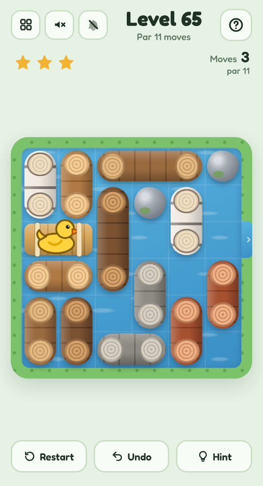

# 🦆 Log Jam

A mobile-friendly, single-file HTML sliding-block puzzle in the style of *Rush Hour*, set on a river. Slide the floating logs to clear a channel so the duckling's raft can drift out through the gap in the bank.

## Play it

The whole game is this folder's `index.html`: open it directly in any browser (phone or desktop), or host it with GitHub Pages:

1. Put this folder's files in a GitHub repo.
2. In the repo, go to **Settings → Pages**, set **Source** to **Deploy from a branch**, pick your branch and `/ (root)`, then **Save**.
3. The game goes live at `https://<your-username>.github.io/<repo-name>/`.

No build step and nothing to install. CSS, JavaScript, levels and audio are all inlined in `index.html`; the other files (`manifest.json`, `sw.js` and `icons/`) only make it installable as an app.

## Install it on your phone

Once it's hosted over HTTPS (GitHub Pages is perfect), open it on the phone, then:

- **Android (Chrome):** tap **Install app** when it's offered, or open the **⋮** menu → **Install app** (or **Add to Home screen**).
- **iPhone / iPad (Safari):** tap **Share** → **Add to Home Screen**.

It gets its own icon, opens full screen without the browser bars, and works offline after the first visit. On iPhone and iPad the home-screen app keeps its own saved progress, separate from Safari's.

## How to play

- **Drag** a log to slide it along its length. Logs never turn, and rocks never move.
- Get the **raft** to the gap on the right-hand bank and it floats away home.
- One move is one slide, however far. Every river shows its **par** — the fewest moves possible.
- Finish in par for **three stars**. **Undo** is free; **Hint** shows the best next slide (and caps the river at two stars).

## Features

- **300 rivers** that ramp from 3-move warm-ups to 46-move brain-benders, then endless remixes of the toughest ones.
- Every level was generated by exploring its entire space of positions and keeping the start that's farthest from a solution, so par is exact — the hint solver proves it live.
- Several wood types, from oak to birch, plus mossy rocks in later rivers.
- Keyboard play on desktop: Tab to a log, arrow keys to slide it.
- Light and dark mode, safe-area-aware layout and big tap targets, so it plays well one-handed on a phone.
- **Background music** and **sound effects**, each off by default and toggled separately from the header. All audio is synthesised live with the Web Audio API — there are no audio files.
- Progress saves in your browser (`localStorage`), including a level you're halfway through.
- A level picker (20 per page) shows your best result for every level you've finished.

Part of the [Puzzle Parlour](../README.md) collection.
