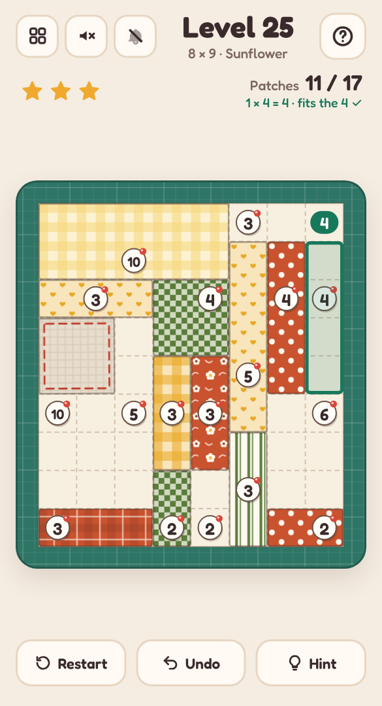

# 🪡 Patchwork

A mobile-friendly, single-file HTML logic puzzle in the style of Shikaku (rectangle division) — told as quilting. Cut a quilt into rectangular patches, one pin in each; when it's done, the seams are sewn, the quilt puffs up, gets its binding and goes into your quilt chest.

## Play it

The whole game is this folder's `index.html`: open it directly in any browser (phone or desktop), or host it with GitHub Pages:

1. Put this folder's files in a GitHub repo.
2. In the repo, go to **Settings → Pages**, set **Source** to **Deploy from a branch**, pick your branch and `/ (root)`, then **Save**.
3. The game goes live at `https://<your-username>.github.io/<repo-name>/`.

No build step and nothing to install. CSS, JavaScript, levels and audio are all inlined in `index.html`; the other files (`manifest.json`, `sw.js` and `icons/`) only make it installable as an app.

## Install it on your phone

Once it's hosted over HTTPS (GitHub Pages is perfect), open it on the phone, then:

- **Android (Chrome):** tap **Install app** when it's offered, or open the **⋮** menu → **Install app** (or **Add to Home screen**).
- **iPhone / iPad (Safari):** tap **Share** → **Add to Home Screen**.

It gets its own icon, opens full screen without the browser bars, and works offline after the first visit. On iPhone and iPad the home-screen app keeps its own saved progress, separate from Safari's.

## How to play

- The quilt has pins with numbers on them. Cut the whole quilt into rectangles so that each rectangle holds **exactly one pin**, and that pin's number is the rectangle's **size** (how many squares it covers).
- **Drag** from one corner square to the opposite corner to cut a patch. While you drag, the outline shows its size and turns calm green when it would make a proper patch, or dashed red when it wouldn't (and the line at the top says why). Tap a **1** to cut it on its own.
- A patch that fits its pin is cut from a printed fabric. One that doesn't is only **tacked on**: plain muslin with loose basting stitches, wobbling gently, so you can see it still needs work.
- **Tap a patch** to unpick it, or simply cut over it: a new patch replaces whatever it overlaps. **Undo** steps back.
- Stuck? The **bulb** sews in a patch that logic can find next and tells you why ("The 4 in the corner can only fit one way"). Finish with no hints for **three stars**; one hint caps it at two, two or more at one. Cutting every patch in a single snip (cuts equal to par) earns a special mention.
- Big quilt? **Pinch** to zoom in, and drag with two fingers (or one finger along the cutting mat) to look around. A cut that reaches the edge of the window slides the quilt along with it, and the magnifier button zooms back out.
- Every quilt has exactly one answer, and logic alone gets you there — never guessing.

## Features

- **Three hand-cut opening quilts** (3×3, 4×4 and 5×5), then **endless quilts** cut on your device, growing from 5×5 to 12×13. Each one is checked with a logic solver before you see it, and level N is the same quilt on every device.
- Every quilt has its own **coordinated palette** (strawberry, seaside, meadow, lavender, harvest and more) and ten little prints — gingham, polka dots, stripes, florals, stars, herringbone, plaid, ticking, hearts and checks — with neighbouring patches always in different prints.
- Finishing a quilt pulls the pins, runs **running-stitch seams** round every patch, puffs the quilt up and sews on a **binding**. Finished quilts appear as thumbnails in the level picker — your quilt chest.
- **Pinch to zoom** on big quilts. One finger still cuts: a touch waits a moment before it counts, so starting a pinch never cuts a patch.
- Keyboard play on desktop: arrow keys move, Enter starts a cut and Enter again finishes it, Delete unpicks, Ctrl+Z undoes. Right-click unpicks too. The mouse wheel or a trackpad pinch zooms, middle-drag moves around, and **+**, **−** and **0** zoom from the keyboard.
- Light and dark mode, safe-area-aware layout and big tap targets, so it plays well one-handed on a phone.
- **Background music** (a homely folk waltz) and **sound effects** (scissor snips, pin clicks and a sewing-machine whirr), each off by default and toggled separately from the header. All audio is synthesised live with the Web Audio API — there are no audio files.
- Progress saves in your browser (`localStorage`), including a quilt you're halfway through.
- A level picker (20 per page) shows your best result for every level you've finished.

Part of the [Puzzle Parlour](../README.md) collection.
