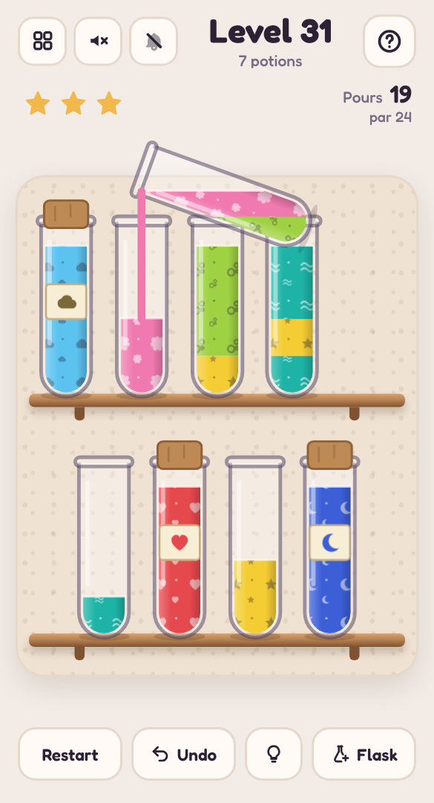

# 🧪 Potion Shelf

A mobile-friendly, single-file HTML colour-sorting puzzle in the style of *water sort*, set in a herbalist's shop. Pour the mixed-up potions between bottles until each bottle holds just one, then watch it get corked and labelled.

## Play it

The whole game is this folder's `index.html`: open it directly in any browser (phone or desktop), or host it with GitHub Pages:

1. Put this folder's files in a GitHub repo.
2. In the repo, go to **Settings → Pages**, set **Source** to **Deploy from a branch**, pick your branch and `/ (root)`, then **Save**.
3. The game goes live at `https://<your-username>.github.io/<repo-name>/`.

No build step and nothing to install. CSS, JavaScript, levels and audio are all inlined in `index.html`; the other files (`manifest.json`, `sw.js` and `icons/`) only make it installable as an app.

## Install it on your phone

Once it's hosted over HTTPS (GitHub Pages is perfect), open it on the phone, then:

- **Android (Chrome):** tap **Install app** when it's offered, or open the **⋮** menu → **Install app** (or **Add to Home screen**).
- **iPhone / iPad (Safari):** tap **Share** → **Add to Home Screen**.

It gets its own icon, opens full screen without the browser bars, and works offline after the first visit. On iPhone and iPad the home-screen app keeps its own saved progress, separate from Safari's.

## How to play

- **Tap** a bottle to pick it up, then **tap** another bottle to pour into it.
- You can only pour onto **the same colour**, or into an **empty bottle**. A bottle holds four measures.
- Matching colours on top pour together, as much as fits.
- Fill a bottle with four of one colour and it's **corked and labelled**. Bottle every potion to win.
- Finish in **par** pours for three stars. **Undo** is free. A **hint** shows a good pour, and the one-off **spare flask** helps when you're stuck; either caps the level at two stars.

## Features

- **Real-looking pours:** the bottle lifts over its target and tips until the liquid brims at the lip. The liquid stays level inside the tilted glass as it streams into the other bottle, which fills as you watch. Same-coloured measures settle into one liquid.
- **Endless levels** generated on your device, the same on every device for a given level number, growing from 2 to 12 potions. Every deal is checked by a solver before you see it, so it can always be finished. Par comes from a search for a short solution, so it's a real target.
- **Cloudy brews** every so often: the lower measures stay hidden in mist until they're uncovered, with a little more room in the par.
- Twelve potions, from Rosehip Tonic to Moonwater, each with its own sparkles floating in it (hearts, stars, leaves, moons, waves and more) so they're easy to tell apart, not just by colour.
- Finished potions get a cork, a label and a little burst of sparkles; on a win, bubbles rise from every bottle. Finished levels show their potions in the level picker.
- Mouse and keyboard play on desktop: arrow keys move between bottles, Enter picks up and pours.
- Light and dark mode, safe-area-aware layout and big tap targets, so it plays well one-handed on a phone.
- **Background music** and **sound effects**, each off by default and toggled separately from the header: a gentle apothecary waltz with the odd bubble, glass clinks, glugs that climb as a bottle fills, and a cork pop. All audio is synthesised live with the Web Audio API; there are no audio files.
- Progress saves in your browser (`localStorage`), including a level you're halfway through.
- A level picker (20 per page) shows your best result for every level you've finished.

Part of the [Puzzle Parlour](../README.md) collection.
