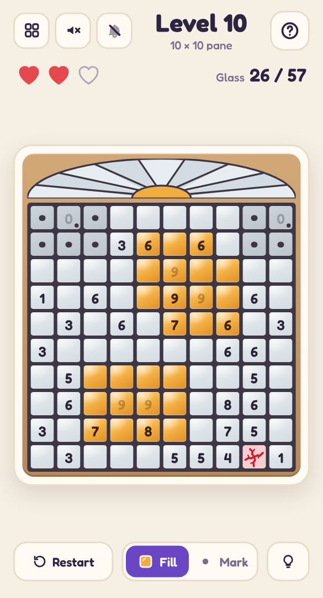

# 🪟 Sun Catcher

A mobile-friendly, single-file HTML picture-logic puzzle in the style of Fill-a-Pix (mosaic logic) — told as stained glass. Use the number clues to find every glass square in a leaded window; when it's done, the sun pours through, each pane lights up in its own colour, and the window joins your collection.

## Play it

The whole game is this folder's `index.html`: open it directly in any browser (phone or desktop), or host it with GitHub Pages:

1. Put this folder's files in a GitHub repo.
2. In the repo, go to **Settings → Pages**, set **Source** to **Deploy from a branch**, pick your branch and `/ (root)`, then **Save**.
3. The game goes live at `https://<your-username>.github.io/<repo-name>/`.

No build step and nothing to install. CSS, JavaScript, levels and audio are all inlined in `index.html`; the other files (`manifest.json`, `sw.js` and `icons/`) only make it installable as an app.

## Install it on your phone

Once it's hosted over HTTPS (GitHub Pages is perfect), open it on the phone, then:

- **Android (Chrome):** tap **Install app** when it's offered, or open the **⋮** menu → **Install app** (or **Add to Home screen**).
- **iPhone / iPad (Safari):** tap **Share** → **Add to Home Screen**.

It gets its own icon, opens full screen without the browser bars, and works offline after the first visit. On iPhone and iPad the home-screen app keeps its own saved progress, separate from Safari's.

## How to play

- Some squares hold a number: how many squares in the 3×3 block centred on it are glass, itself included (fewer squares at the edges).
- **Tap or drag** to fill glass. A square that isn't glass cracks and costs one of your **3 hearts**.
- Switch to **Mark** to dot squares you know are clear (dots are just notes; they never cost a heart). You only need to find the glass.
- Once a number has all its glass, the rest of its block is dotted for you. A number fades when its whole block is settled, and turns red if a dot has made it impossible.
- Stuck? The **bulb** lights up a number (or two numbers side by side) that settles some squares, and explains why in plain words.
- Big window? **Pinch** to zoom in, and drag with two fingers (or one finger along the frame) to look around. The magnifier button zooms back out.
- Every puzzle has exactly one answer, and logic alone gets you there — never guessing.

## Features

- **20 hand-leaded pictures** (5×5 up to 15×15) — a sun, a tulip, an owl, a lighthouse, a tree of life, a great rose window and more — then **endless windows** generated on your device: symmetric rosettes, medallions, quatrefoils, stars and bordered panes in jewel-tone glass.
- Clues are carved away from a full set in a seeded order, as far as a logic solver can still finish the puzzle, so windows are sparse but always solvable. The first five need only one number at a time; later ones ask you to compare two neighbouring numbers.
- Finishing a window **lets the light in**: the sunburst fanlight glows, each pane takes its colour from the top corner down, and a sunbeam sweeps across the glass. Finished windows appear as thumbnails in the level picker — your collection.
- Hints that teach: each one highlights the number(s) it uses and says what they force, e.g. "This 7 needs every square around it but two, and those two are already clear, so the glowing squares are glass."
- **Pinch to zoom** on big windows. One finger still fills: a touch waits a moment before it counts, so starting a pinch never costs a heart.
- Keyboard play on desktop: arrow keys move, Enter fills, X marks. Right-click marks too, and hovering over a number outlines its block. The mouse wheel or a trackpad pinch zooms, middle-drag moves around, and **+**, **−** and **0** zoom from the keyboard.
- Light and dark mode, safe-area-aware layout and big tap targets, so it plays well one-handed on a phone.
- **Background music** (bells and harp) and glassy **sound effects**, each off by default and toggled separately from the header. All audio is synthesised live with the Web Audio API — there are no audio files.
- Progress saves in your browser (`localStorage`), including a window you're halfway through.
- A level picker (20 per page) shows your best result for every level you've finished.

Part of the [Puzzle Parlour](../README.md) collection.
