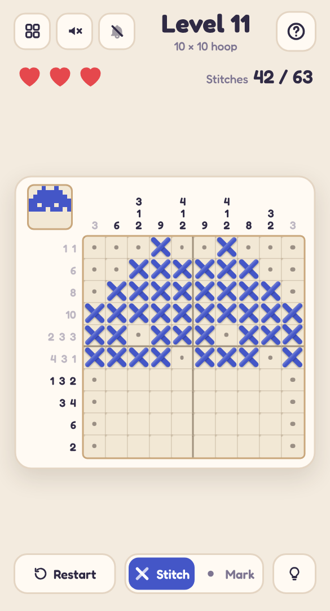

# 🧵 Thread Count

A mobile-friendly, single-file HTML picture-logic puzzle in the style of a nonogram — told as cross-stitch. Use the number clues to stitch a hidden picture; when it's done, the embroidery blooms into full colour and joins your sampler.

## Play it

The whole game is this folder's `index.html`: open it directly in any browser (phone or desktop), or host it with GitHub Pages:

1. Put this folder's files in a GitHub repo.
2. In the repo, go to **Settings → Pages**, set **Source** to **Deploy from a branch**, pick your branch and `/ (root)`, then **Save**.
3. The game goes live at `https://<your-username>.github.io/<repo-name>/`.

No build step and nothing to install. CSS, JavaScript, levels and audio are all inlined in `index.html`; the other files (`manifest.json`, `sw.js` and `icons/`) only make it installable as an app.

## Install it on your phone

Once it's hosted over HTTPS (GitHub Pages is perfect), open it on the phone, then:

- **Android (Chrome):** tap **Install app** when it's offered, or open the **⋮** menu → **Install app** (or **Add to Home screen**).
- **iPhone / iPad (Safari):** tap **Share** → **Add to Home Screen**.

It gets its own icon, opens full screen without the browser bars, and works offline after the first visit. On iPhone and iPad the home-screen app keeps its own saved progress, separate from Safari's.

## How to play

- Each row and column has clues: the lengths of its runs of stitches, in order. Runs are separated by at least one empty square.
- **Tap or drag** across squares to stitch them. A wrong stitch shows a red cross and costs one of your **3 hearts**.
- Switch to **Mark** to dot squares you know are empty (dots are just notes; they never cost a heart).
- Finished rows and columns grey out and their leftover squares are dotted for you.
- Stuck? The **bulb** highlights a square that one row or column already pins down, and tells you which.
- Every puzzle has exactly one answer, and logic alone gets you there — never guessing.

## Features

- **24 hand-drawn pictures** (5×5 up to 15×15) — a heart, a ginger cat, a teapot, a lighthouse and more — then **endless quilt motifs** generated on your device, each checked with a line-by-line logic solver before you see it.
- Finished pictures **bloom into their real colours**, rippling out from the middle, and appear as thumbnails in the level picker — your sampler.
- A live mini-preview of your stitching in the corner of the hoop.
- Keyboard play on desktop: arrow keys move, Enter stitches, X marks. Right-click marks too.
- Light and dark mode, safe-area-aware layout and big tap targets, so it plays well one-handed on a phone.
- **Background music** and **sound effects**, each off by default and toggled separately from the header. All audio is synthesised live with the Web Audio API — there are no audio files.
- Progress saves in your browser (`localStorage`), including a level you're halfway through.
- A level picker (20 per page) shows your best result for every level you've finished.

Part of the [Puzzle Parlour](../README.md) collection.
