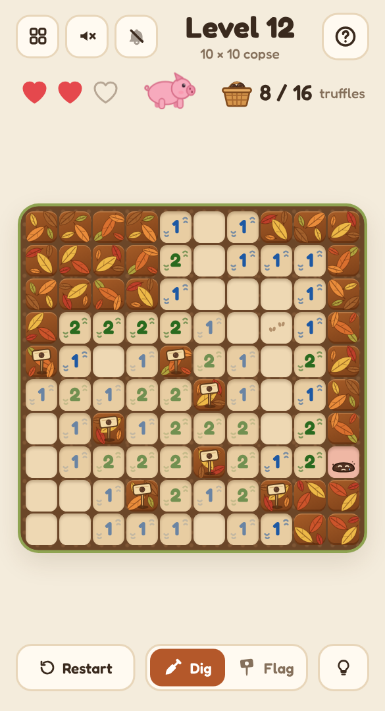

# 🐷 Truffle Hunt

A mobile-friendly, single-file HTML logic puzzle in the style of a hidden-hazard number puzzle — told as a truffle hunt on the forest floor, where you never have to guess. Follow the pig's sniff numbers, dig every safe square, and stake out the truffles; when the hunt is done they tumble into the basket and the finished floor joins your collection of truffle maps.

## Play it

The whole game is this folder's `index.html`: open it directly in any browser (phone or desktop), or host it with GitHub Pages:

1. Put this folder's files in a GitHub repo.
2. In the repo, go to **Settings → Pages**, set **Source** to **Deploy from a branch**, pick your branch and `/ (root)`, then **Save**.
3. The game goes live at `https://<your-username>.github.io/<repo-name>/`.

No build step and nothing to install. CSS, JavaScript, levels and audio are all inlined in `index.html`; the other files (`manifest.json`, `sw.js` and `icons/`) only make it installable as an app.

## Install it on your phone

Once it's hosted over HTTPS (GitHub Pages is perfect), open it on the phone, then:

- **Android (Chrome):** tap **Install app** when it's offered, or open the **⋮** menu → **Install app** (or **Add to Home screen**).
- **iPhone / iPad (Safari):** tap **Share** → **Add to Home Screen**.

It gets its own icon, opens full screen without the browser bars, and works offline after the first visit. On iPhone and iPad the home-screen app keeps its own saved progress, separate from Safari's.

## How to play

- Truffles are hidden under some of the leaf-covered squares. **Tap** a square to dig it: if there's no truffle, it shows the pig's sniff — how many truffles are in the 8 squares around it. Squares with nothing nearby open up their neighbours.
- Every hunt starts with the pig's clearing already dug (look for the hoofprints).
- Mark truffles you've worked out with a wooden marker stick: switch to **Flag**, or **press and hold** a square (right-click on desktop).
- Tap a number whose flags are all placed and the pig digs the rest of the squares around it.
- Dig up a truffle by mistake and it's squashed: it's shown and flagged for you, and it costs one of your **3 hearts**. Lose all three and the hunt is over.
- Dig every truffle-free square to win. Flags are optional.
- Stuck? The **bulb** highlights a square that's certainly safe or certainly a truffle, and explains which numbers prove it ("This 2 already touches two flagged truffles, so…").
- Big wood? **Pinch** to zoom in, and drag to look around. The magnifier button zooms back out.
- Every hunt can be finished by logic alone from the first clearing — you never have to guess.

## Features

- **A gentle opening run of 20 hunts** (5×5 with 3 truffles, up to 12×16), then **endless woods** of 10×12 to 12×16 at 16–20% truffles. Every level is made on your device and checked by a logic solver (single numbers, pairs of numbers, and small groups tried every possible way) before you see it; level N is the same hunt on every device.
- Layered autumn-leaf squares that rustle away as you dig, warm soil with colour-coded sniff numbers, marker sticks, sad little squashed truffles, and a truffle pig who sniffs along with your hints.
- When you win, the pig trots happily and the truffles tumble into the basket. Finished hunts appear as tiny **truffle maps** in the level picker — your collection.
- Hints that explain themselves, one step at a time.
- Keyboard play on desktop: arrow keys move, Enter or Space digs, F flags. Right-click flags. The mouse wheel or a trackpad pinch zooms, middle-drag moves around, and **+**, **−** and **0** zoom from the keyboard.
- Light and dark mode, safe-area-aware layout and big tap targets, so it plays well one-handed on a phone.
- **Background music** (a woodland stroll with birdsong) and **sound effects**, each off by default and toggled separately from the header. All audio is synthesised live with the Web Audio API — there are no audio files.
- Progress saves in your browser (`localStorage`), including a hunt you're halfway through.
- A level picker (20 per page) shows your best result for every level you've finished.

Part of the [Puzzle Parlour](../README.md) collection.
